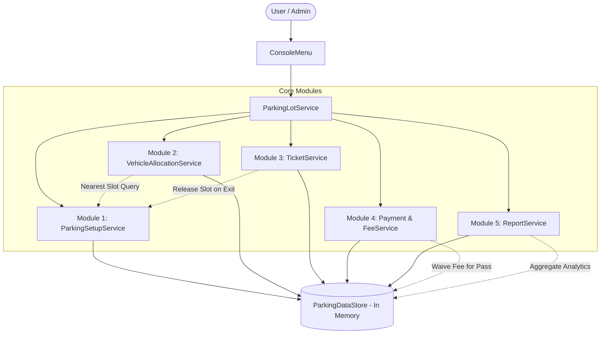
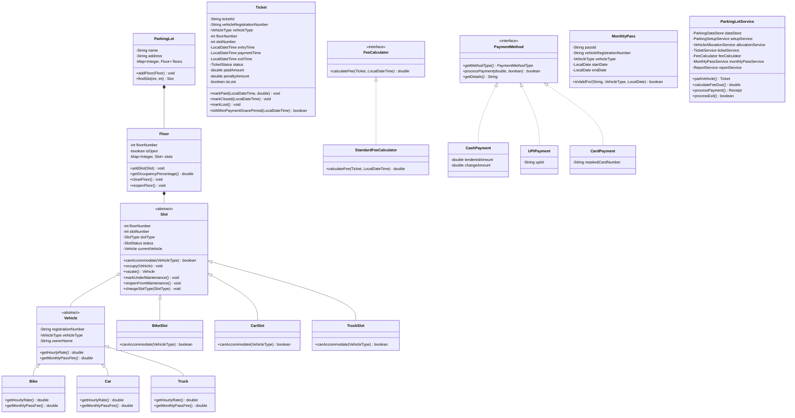
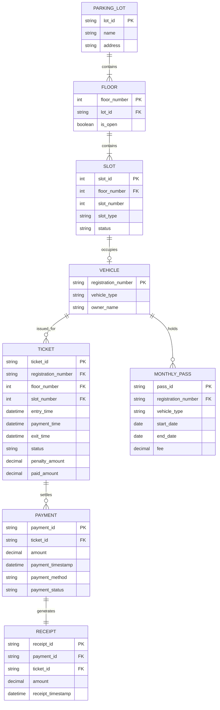

# ParkEase – Multi-Floor Parking Lot Management System (Low-Level Design)

An enterprise-grade, academic Low-Level Design (LLD) terminal application developed in **Java 21** demonstrating Object-Oriented Programming (OOP) principles, clean modular architecture, and robust parking management business logic.

---

## Table of Contents
1. [Project Overview](#1-project-overview)
2. [Problem Statement & Background](#2-problem-statement--background)
3. [Technology Stack](#3-technology-stack)
4. [Project Architecture & Directory Structure](#4-project-architecture--directory-structure)
5. [Module Descriptions & Class Responsibilities](#5-module-descriptions--class-responsibilities)
6. [OOP Concepts & SOLID Principles Demonstrated](#6-oop-concepts--solid-principles-demonstrated)
7. [System Diagrams](#7-system-diagrams)
   - [High-Level Module Interaction Diagram](#high-level-module-interaction-diagram)
   - [Mermaid Class Diagram](#mermaid-class-diagram)
   - [Entity Relationship (ER) Diagram](#entity-relationship-er-diagram)
8. [SQL Exercise (Schema & Analytical Queries)](#8-sql-exercise)
9. [Business Rules & Formulas](#9-business-rules--formulas)
10. [Compilation & Execution Guide](#10-compilation--execution-guide)
11. [Testing Scenarios & Acceptance Criteria](#11-testing-scenarios--acceptance-criteria)
12. [Sample Terminal Output Session](#12-sample-terminal-output-session)
13. [Known Limitations & Future Enhancements](#13-known-limitations--future-enhancements)

---

## 1. Project Overview

**ParkEase** is a command-line parking lot management system designed to coordinate multi-floor parking operations for Cars, Bikes, and Trucks. It manages the entire lifecycle of parking:
- Administrative parking lot configuration (floors, slot capacities, maintenance, closures).
- Real-time vehicle registration and intelligent nearest-slot allocation.
- Ticket issuing, lost ticket penalty workflows, and exit window enforcement.
- Tiered hourly fee calculation, daily 8-hour rate caps, and monthly passes.
- Polymorphic payment simulation (Cash, UPI, Card) and receipt generation.
- Dynamic analytical reporting, occupancy metrics (excluding maintenance slots), and 24-hour continuous stay security alerts.

---

## 2. Problem Statement & Background

Urban commercial centres require automated, collision-free slot allocation algorithms, fair billing with daily maximums and grace periods, and strict capacity monitoring. 

Key constraints addressed in ParkEase:
- **Vehicle Hierarchy & Allocation**:
  - Bikes prefer dedicated Bike slots; when full, they may safely overflow into Car slots.
  - Cars are strictly restricted to Car slots.
  - Trucks are strictly restricted to Truck slots.
- **Nearest Slot Priority**: Slots are allocated on the lowest floor number first, then lowest slot number.
- **Floor State Safety**: Closed floors prohibit new check-ins while allowing already parked vehicles to exit normally.
- **Grace Windows & Daily Caps**:
  - First 15 minutes of parking are free.
  - Parking after 15 minutes is rounded up to the next full hour.
  - Daily parking fee is capped at 8 hours of the vehicle's hourly rate per 24-hour block.
  - Post-payment exit grace period is 15 minutes. Vehicles remaining beyond 15 minutes are recalculated for additional fees.
- **Lost Ticket Handling**: Immediate verification via vehicle registration with a flat penalty of ₹500 added to the calculated fee.
- **Occupancy & Security Alerts**:
  - Floor occupancy exceeding 90% triggers automated administrative warnings.
  - Maintenance slots are strictly excluded from occupancy percentage denominators.
  - Continuous parking exceeding 24 hours flags a long-stay security warning.

---

## 3. Technology Stack

- **Language**: Java 21 (Standard Edition)
- **Data Structures**: `TreeMap`, `LinkedHashMap`, `ArrayList`, `HashSet`, `EnumMap`
- **Date & Time API**: `java.time.LocalDateTime`, `java.time.LocalDate`, `java.time.Duration`
- **I/O & CLI**: `java.util.Scanner` with input sanitization and formatted ANSI tables
- **Design Patterns**: Aggregate Root, Strategy, Facade, Value Object
- **Testing**: Built-in automated assertion runners (`Module1Test` through `Module5Test` and `EndToEndIntegrationTest`)

---

## 4. Project Architecture & Directory Structure

```
ParkEase/
├── src/
│   ├── common/
│   │   ├── Enums.java                # Centralized domain enumerations
│   │   ├── Vehicle.java              # Abstract base vehicle class
│   │   ├── Bike.java                 # Concrete Bike entity
│   │   ├── Car.java                  # Concrete Car entity
│   │   ├── Truck.java                # Concrete Truck entity
│   │   ├── Slot.java                 # Abstract base slot class
│   │   ├── BikeSlot.java             # Concrete Bike slot
│   │   ├── CarSlot.java              # Concrete Car slot (accommodates Cars & overflow Bikes)
│   │   ├── TruckSlot.java            # Concrete Truck slot
│   │   ├── Ticket.java               # Parking session ticket entity
│   │   └── ParkingDataStore.java     # Shared in-memory data store with seed data
│   │
│   ├── module1_setup/
│   │   ├── Admin.java                # Administrator model with authentication
│   │   ├── Floor.java                # Aggregate root for floor-level slots
│   │   ├── ParkingLot.java           # Facility aggregate root
│   │   └── ParkingSetupService.java  # Admin configuration and slot maintenance service
│   │
│   ├── module2_allocation/
│   │   └── VehicleAllocationService.java # Nearest-slot search & vehicle entry service
│   │
│   ├── module3_ticket/
│   │   └── TicketService.java        # Ticket lifecycle, lost ticket, and exit validation
│   │
│   ├── module4_payment/
│   │   ├── FeeCalculator.java        # Strategy interface for fee calculation
│   │   ├── StandardFeeCalculator.java# 15-min free, 8-hr cap, tiered fee engine
│   │   ├── PaymentMethod.java        # Polymorphic payment method interface
│   │   ├── CashPayment.java          # Cash tender and change processing
│   │   ├── UPIPayment.java           # UPI VPA transaction simulation
│   │   ├── CardPayment.java          # Masked card transaction simulation
│   │   ├── Payment.java              # Transaction audit log record
│   │   ├── MonthlyPass.java          # Subscription pass domain model
│   │   ├── MonthlyPassService.java   # Monthly pass issuance and validity check
│   │   └── Receipt.java              # Formatted printable customer receipt
│   │
│   ├── module5_reports/
│   │   └── ReportService.java        # Occupancy analytics, daily revenue, and alerts
│   │
│   ├── service/
│   │   └── ParkingLotService.java    # Unified Facade unifying all 5 modules
│   │
│   ├── ui/
│   │   └── ConsoleMenu.java          # Robust, interactive 12-option terminal UI
│   │
│   ├── test/
│   │   ├── Module1Test.java          # Module 1 independent test runner
│   │   ├── Module2Test.java          # Module 2 independent test runner
│   │   ├── Module3Test.java          # Module 3 independent test runner
│   │   ├── Module4Test.java          # Module 4 independent test runner
│   │   ├── Module5Test.java          # Module 5 independent test runner
│   │   └── EndToEndIntegrationTest.java # Comprehensive 24-scenario acceptance suite
│   │
│   └── Main.java                     # Application bootstrap entry point
│
└── README.md                         # Comprehensive architectural documentation
```

---

## 5. Module Descriptions & Class Responsibilities

| Module | Primary Classes | Key Responsibilities |
| :--- | :--- | :--- |
| **Common** | `Vehicle`, `Slot`, `Ticket`, `Enums`, `ParkingDataStore` | Encapsulates domain models, polymorphic rules, slot states (`FREE`, `OCCUPIED`, `UNDER_MAINTENANCE`), and single source of truth in-memory collections. |
| **Module 1: Setup** | `Admin`, `Floor`, `ParkingLot`, `ParkingSetupService` | Enforces admin credentials; manages multi-floor initialization, slot allocation, maintenance toggling, and floor closures. |
| **Module 2: Allocation** | `VehicleAllocationService` | Enforces registration uniqueness; implements nearest-slot search algorithm (`lowest floor` → `lowest slot`); handles Bike overflow into Car slots. |
| **Module 3: Ticket & Exit** | `TicketService` | Issues unique ticket sequences (`TKT-1001`); manages state transitions (`ACTIVE` → `PAID` → `CLOSED` or `LOST`); enforces 15-minute post-payment exit grace period; applies ₹500 lost penalty. |
| **Module 4: Fee & Payment** | `StandardFeeCalculator`, `PaymentMethod`, `MonthlyPassService`, `Receipt` | Calculates hourly fees with 15-min free threshold and 8-hr cap; validates monthly passes; processes polymorphic payments (Cash, UPI, Card); prints receipts. |
| **Module 5: Reports** | `ReportService` | Computes floor/slot type occupancy; isolates daily revenue; detects >90% floor occupancy alerts and >24 hour vehicle stay warnings. |
| **Facade & UI** | `ParkingLotService`, `ConsoleMenu`, `Main` | Provides single unified business API preventing tight coupling between UI and business layers; presents interactive terminal menu. |

---

## 6. OOP Concepts & SOLID Principles Demonstrated

### 1. Encapsulation
- All domain entity fields (`Vehicle`, `Slot`, `Ticket`, `Payment`, `Floor`, `ParkingLot`) are strictly `private` or `final`.
- State transitions are guarded by domain methods (e.g. `Slot.markUnderMaintenance()` forbids maintenance if occupied; `Slot.changeSlotType()` rejects changing occupied slots; `Ticket.markPaid()` verifies timestamps).

### 2. Inheritance
- `Vehicle` abstract base class extended by `Bike`, `Car`, and `Truck`.
- `Slot` abstract base class extended by `BikeSlot`, `CarSlot`, and `TruckSlot`.

### 3. Polymorphism
- **Slot Accommodation**: `BikeSlot.canAccommodate()` accepts only `BIKE`, whereas `CarSlot.canAccommodate()` polymorphically accepts `CAR` and `BIKE`.
- **Payment Execution**: `PaymentMethod` interface implemented polymorphically by `CashPayment` (tendered/change calculation), `UPIPayment` (VPA validation), and `CardPayment` (PAN masking).
- **Vehicle Rates**: Vehicle subclasses polymorphically supply hourly rates and monthly pass subscription fees.

### 4. Abstraction
- `FeeCalculator` interface decouples fee computation strategies from ticket and payment workflows.
- `PaymentMethod` decouples payment collection from ticket settlement.
- Service classes hide internal collection mutations from callers.

### 5. SOLID Principles
- **Single Responsibility Principle (SRP)**: Each service specializes in one domain (Setup, Allocation, Tickets, Payments, Reports).
- **Open/Closed Principle (OCP)**: New payment types (e.g., `CryptoPayment`, `FastagPayment`) or fee strategies can be added without altering existing ticket or checkout services.
- **Liskov Substitution Principle (LSP)**: Any `Slot` subclass behaves reliably in place of the base `Slot`.
- **Interface Segregation Principle (ISP)**: Focused, minimal interfaces (`PaymentMethod`, `FeeCalculator`).
- **Dependency Inversion Principle (DIP)**: `ParkingLotService` depends on `FeeCalculator` abstraction rather than concrete implementations.

---

## 7. System Diagrams

### High-Level Module Interaction Diagram



---

### Mermaid Class Diagram



---

### Entity Relationship (ER) Diagram



---

## 8. SQL Exercise

The problem statement requires analytical SQL queries based on the logical schema:

### Query 1: Vehicle Type Performance
*For each vehicle type, find the total number of tickets issued, the total revenue collected, and the average parking duration in minutes. Show only vehicle types that have more than 2 tickets. Sort by total revenue in descending order.*

```sql
SELECT 
    t.vehicle_type,
    COUNT(t.ticket_id) AS total_tickets_issued,
    COALESCE(SUM(p.amount), 0.00) AS total_revenue_collected,
    ROUND(AVG(TIMESTAMPDIFF(MINUTE, t.entry_time, COALESCE(t.exit_time, NOW()))), 2) AS avg_duration_minutes
FROM TICKET t
LEFT JOIN PAYMENT p 
    ON t.ticket_id = p.ticket_id 
    AND p.payment_status = 'PAID'
GROUP BY t.vehicle_type
HAVING COUNT(t.ticket_id) > 2
ORDER BY total_revenue_collected DESC;
```

---

### Query 2: Floor Utilization and Revenue
*For each floor, list the total number of slots, the number of tickets issued, and the total revenue collected. Group the results by floor and include only floors that have issued at least 3 tickets.*

```sql
SELECT 
    f.floor_number,
    COUNT(DISTINCT s.slot_id) AS total_slots,
    COUNT(DISTINCT t.ticket_id) AS tickets_issued,
    COALESCE(SUM(p.amount), 0.00) AS total_revenue_collected
FROM FLOOR f
JOIN SLOT s 
    ON f.floor_number = s.floor_number
LEFT JOIN TICKET t 
    ON f.floor_number = t.floor_number
LEFT JOIN PAYMENT p 
    ON t.ticket_id = p.ticket_id 
    AND p.payment_status = 'PAID'
GROUP BY f.floor_number
HAVING COUNT(DISTINCT t.ticket_id) >= 3
ORDER BY f.floor_number ASC;
```

---

### Query 3: Frequent Visitor Audit
*Find each vehicle's total number of visits, the total fee paid, and the number of distinct floors it has parked on. Include only vehicles that have visited more than 2 times, ordered by total fee paid in descending order.*

```sql
SELECT 
    t.registration_number,
    COUNT(t.ticket_id) AS total_visits,
    COALESCE(SUM(p.amount), 0.00) AS total_fee_paid,
    COUNT(DISTINCT t.floor_number) AS distinct_floors_parked
FROM TICKET t
LEFT JOIN PAYMENT p 
    ON t.ticket_id = p.ticket_id 
    AND p.payment_status = 'PAID'
GROUP BY t.registration_number
HAVING COUNT(t.ticket_id) > 2
ORDER BY total_fee_paid DESC;
```

---

## 9. Business Rules & Formulas

### Hourly Rates & Monthly Passes
| Vehicle Type | Hourly Rate | 8-Hour Daily Cap | Monthly Pass Fee |
| :--- | :--- | :--- | :--- |
| **BIKE** | ₹10 / hr | ₹80 / day | ₹500 / month |
| **CAR** | ₹20 / hr | ₹160 / day | ₹1,500 / month |
| **TRUCK** | ₹40 / hr | ₹320 / day | ₹3,000 / month |

### Fee Calculation Algorithm
1. $\text{Duration} = \text{Payment Time} - \text{Entry Time}$ (in minutes).
2. If $\text{Duration} \le 15 \text{ mins}$, $\text{Fee} = ₹0$.
3. If $\text{Duration} > 15 \text{ mins}$, compute full 24-hour periods:
   $$\text{Full Days} = \lfloor \text{Duration} / 1440 \rfloor$$
   $$\text{Day Charge} = \text{Full Days} \times (8 \times \text{Hourly Rate})$$
4. Compute remaining time:
   $$\text{Remaining Mins} = \text{Duration} \pmod{1440}$$
   $$\text{Chargeable Hours} = \min(8, \lceil \text{Remaining Mins} / 60 \rceil)$$
   $$\text{Remaining Charge} = \text{Chargeable Hours} \times \text{Hourly Rate}$$
5. If ticket was marked **LOST**, add flat penalty of **₹500.00**.
6. Subtract any previously paid amount (for overtime exits).

### Floor Occupancy Percentage Formula
$$\text{Occupancy \%} = \left( \frac{\text{Occupied Slots}}{\text{Free Slots} + \text{Occupied Slots}} \right) \times 100$$
*(Maintenance slots are strictly excluded from the denominator)*.

---

## 10. Compilation & Execution Guide

### Prerequisites
- JDK 17 or higher (tested on **OpenJDK 21**).
- Terminal (PowerShell, Command Prompt, or Bash).

### 1. Compile All Sources
```bash
# From the project root (ParkEase)
javac -d bin src/common/*.java src/module1_setup/*.java src/module2_allocation/*.java src/module3_ticket/*.java src/module4_payment/*.java src/module5_reports/*.java src/service/*.java src/ui/*.java src/Main.java src/test/*.java
```

### 2. Run Module Unit Tests Independently
```bash
# Module 1: Setup Tests
java -ea -cp bin test.Module1Test

# Module 2: Allocation Tests
java -ea -cp bin test.Module2Test

# Module 3: Ticket & Exit Tests
java -ea -cp bin test.Module3Test

# Module 4: Fee & Payment Tests
java -ea -cp bin test.Module4Test

# Module 5: Report Tests
java -ea -cp bin test.Module5Test
```

### 3. Run Full 24-Scenario Acceptance Test Suite
```bash
java -ea -cp bin test.EndToEndIntegrationTest
```

### 4. Launch the Interactive Application
```bash
java -cp bin Main
```

---

## 11. Testing Scenarios & Acceptance Criteria

All 24 required test scenarios pass with zero failures:

1. **Bike receives Bike slot**: Verified at Floor 0, Slot 1.
2. **Bike receives Car slot when Bike slots are full**: Overflow allocation verified at Floor 0, Slot 3.
3. **Car cannot take Bike slot**: Strictly allocated to Car slots.
4. **Truck cannot take Car slot**: Strictly allocated to Truck slots.
5. **Nearest slot priority**: Evaluates lowest floor first, then lowest slot number.
6. **Closed floor ignored**: Allocator bypasses closed floors; accepts them immediately upon reopening.
7. **Occupied slot immutability**: Changing slot type on an occupied slot throws `IllegalStateException`.
8. **Maintenance slot bypass**: Slots under maintenance are skipped by the allocator.
9. **Duplicate vehicle entry**: Active parked vehicle cannot enter again.
10. **15-minute free window**: Fee is ₹0.00 up to 15 minutes.
11. **Hourly rounding**: 16 mins charged as 1 full hour; 65 mins charged as 2 full hours.
12. **Daily 8-hour cap**: 10 hours stay charged at 8 hours (Bike = ₹80, Car = ₹160, Truck = ₹320).
13. **Cross-slot billing**: Bike parked in Car slot is charged at Bike rate (₹10/hr).
14. **Valid monthly pass**: Free parking granted (₹0.00 due).
15. **Expired monthly pass**: Treated as regular vehicle; normal parking fees apply.
16. **Failed payment blocking**: Failed payment prevents vehicle exit.
17. **15-minute exit window**: Successful payment allows exit within 15 minutes.
18. **Overtime exit fee recalculation**: Exiting after 15 minutes reverts ticket to ACTIVE and requires top-up.
19. **Lost ticket penalty**: Lost ticket adds ₹500 flat penalty.
20. **Slot release upon exit**: Exiting restores slot status to FREE.
21. **24-hour continuous stay alert**: Identifies and flags long-duration vehicles.
22. **Floor occupancy alert**: Triggers warning when floor occupancy exceeds 90%.
23. **Maintenance slot denominator exclusion**: Occupancy denominator ignores maintenance slots.
24. **Revenue audit accuracy**: Daily revenue isolates successful payments for the specified date.

---

## 12. Sample Terminal Output Session

```
============================================
       PARKING LOT MANAGEMENT SYSTEM        
============================================
 1. ADMIN PANEL
 2. VEHICLE ENTRY
 3. PARKING SLOT STATUS
 4. TICKET MANAGEMENT
 5. VEHICLE EXIT
 6. FEE CALCULATION
 7. PAYMENT
 8. MONTHLY PASS MANAGEMENT
 9. PARKING REPORTS
 10. MONITORING AND ALERTS
 11. VIEW ALL PARKED VEHICLES
 12. VIEW PAYMENT HISTORY
 0. EXIT APPLICATION
============================================
Enter your choice: 2

--- VEHICLE ENTRY & ALLOCATION ---
Enter Vehicle Registration Number (e.g., KA01AB1234): KA05MN4321
Select Vehicle Type:
1. BIKE (Rs. 10/hr)
2. CAR  (Rs. 20/hr)
3. TRUCK (Rs. 40/hr)
Enter type (1/2/3): 2
Enter Owner Name: Alice Cooper

[SUCCESS] Vehicle parked successfully!
====================================================
                 PARKEASE ENTRY TICKET              
====================================================
 Ticket ID      : TKT-1001
 Vehicle Reg    : KA05MN4321
 Vehicle Type   : CAR
 Allocated Slot : Floor 0, Slot 3 (CAR Slot)
 Entry Time     : 2026-10-30 10:34:59
 Rates          : First 15 mins free | 8-hr daily cap
====================================================

Enter your choice: 7

--- PROCESS PAYMENT ---
Enter Ticket ID or Vehicle Registration Number: KA05MN4321
Vehicle: KA05MN4321 | Total Amount Due: Rs. 40.00

Select Payment Method:
1. CASH
2. UPI
3. CARD
Enter method (1/2/3): 1
Enter Cash Tendered by customer (Rs.): 50

[Console Simulation] Select Transaction Outcome:
1. Simulate Payment SUCCESS
2. Simulate Payment FAILURE / DECLINE
Select (1/2, default 1): 1

====================================================
                 PARKEASE PAYMENT RECEIPT            
====================================================
 Receipt ID     : RCP-9001
 Payment ID     : PAY-7001
 Ticket ID      : TKT-1001
 Vehicle Reg No : KA05MN4321
 Date & Time    : 2026-10-30 10:35:10
 Payment Method : CASH
 Amount Paid    : Rs. 40.00
 Status         : [SUCCESSFUL - PAID]
====================================================
  * Please exit parking within 15 minutes of payment *
====================================================

Enter your choice: 5

--- VEHICLE EXIT GATE ---
Enter Ticket ID or Vehicle Registration Number: KA05MN4321

[SUCCESS] Vehicle KA05MN4321 has successfully exited! Slot Floor 0, Slot 3 is now FREE.
```

---

## 13. Known Limitations & Future Enhancements

1. **In-Memory Storage**: Current state persists in memory during application runtime. In a production deployment, this can be backed by a relational database (PostgreSQL/MySQL) using an ORM or JDBC repository layer.
2. **Dynamic Slot Sizes**: In future iterations, EV charging slots and disabled/handicapped priority slots can be modeled using the existing extensible `Slot` abstraction.
3. **Automated Payment Gateways**: The application currently simulates payment approvals through polymorphic strategy interfaces; integration with Razorpay, Stripe, or FASTag RFID readers can be plugged into `PaymentMethod`.
